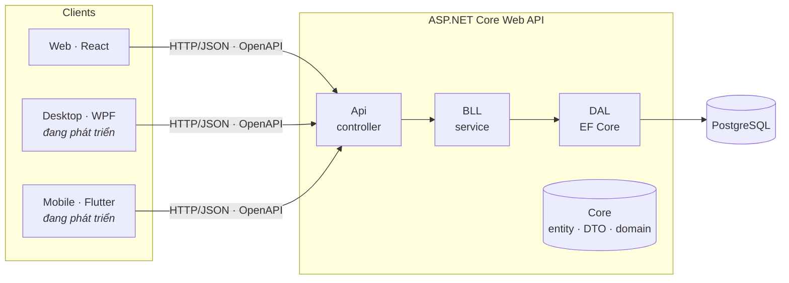

<div align="center">


# Mầm

**Sổ kế hoạch cá nhân giúp bạn biến mục tiêu lớn thành việc nhỏ mỗi ngày.**

*A hand-drawn style personal planner: daily tasks, habits, goals and weekly/yearly plans in one place.*


</div>

---

## Giới thiệu

Mầm gom những thứ bạn thường để rải rác ở nhiều ứng dụng (to-do, theo dõi thói quen, mục tiêu năm, ghi chú tuần) vào một nơi và nối chúng với nhau. Việc tick hôm nay hiện ngay trên kế hoạch tuần. Hạn của từng bước mục tiêu tự xuất hiện trong tuần và trong tháng tương ứng. Mọi con số tiến độ đều tính từ cùng một nguồn dữ liệu nên luôn khớp nhau.

Giao diện theo phong cách vẽ tay trên nền giấy kẻ ô, dùng tốt trên cả máy tính lẫn điện thoại.

## Tính năng

| Màn hình | Bạn làm được gì |
|----------|-----------------|
| **Hôm nay** | Việc cần làm kèm bước con, thói quen trong ngày, ghi chú nhanh, việc còn tồn từ hôm trước, lịch tháng/tuần để lên kế hoạch trước, vòng tiến độ và biểu đồ những ngày gần đây |
| **Kế hoạch tuần** | 7 cột ngày, kéo thả việc giữa các ngày, ghi chú tuần, các hạn mục tiêu trong tuần, biểu đồ tiến độ theo ngày hoặc theo 12 tuần |
| **Theo dõi thói quen** | Lưới tick theo tháng hoặc tuần, chuỗi ngày liên tiếp, biểu đồ mức hoàn thành từng ngày |
| **Mục tiêu & tầm nhìn** | Mục tiêu chia theo lĩnh vực cuộc sống, các bước có hạn, biểu đồ radar cân bằng giữa các lĩnh vực |
| **Việc lặp lại** | Việc tự sinh theo lịch (hằng ngày, các thứ trong tuần…), bỏ qua được từng ngày |

Ngoài ra:

- **Responsive:** thanh điều hướng đáy trên điện thoại, sidebar trên máy tính.
- **Kéo thả** dùng được bằng chuột, cảm ứng và bàn phím.
- **4 bộ màu:** Rừng xanh, Biển đêm, Hoàng hôn, Oải hương.
- **Hai ngôn ngữ:** tiếng Việt và tiếng Anh.
- **Phản hồi tức thì:** giao diện cập nhật ngay khi bạn thao tác, rồi đồng bộ với máy chủ ở nền.

## Công nghệ

| Phần | Công nghệ |
|------|-----------|
| Backend | ASP.NET Core Web API (.NET 10), Entity Framework Core, PostgreSQL, FluentValidation, OpenAPI + Scalar |
| Frontend | React 19, TypeScript, Vite, Tailwind CSS 4, TanStack Query, Zustand, React Router, dnd-kit, Recharts, i18next |
| Kiểm thử | xUnit (backend), Vitest + Testing Library (frontend) |
| Hạ tầng dev | Docker Compose cho PostgreSQL |

## Kiến trúc



- **Backend nhiều tầng (N-layer)** chia theo tính năng. Các phép tính tiến độ, chuỗi ngày, quá hạn là hàm thuần trong `Core` nên kiểm thử được mà không cần database.
- **Backend là nguồn sự thật duy nhất cho số liệu.** Client chỉ hiển thị, nhờ vậy web, desktop và mobile luôn ra cùng một con số.
- **Kiểu dữ liệu frontend sinh tự động từ OpenAPI**, đổi API là TypeScript báo lỗi ngay chỗ cần sửa.
- **Monorepo:** frontend và backend nằm chung repo để giữ đồng bộ hợp đồng API, nhưng build và deploy độc lập.

## Chạy thử trên máy

Cần cài [.NET 10 SDK](https://dotnet.microsoft.com/download), [Node.js 24](https://nodejs.org/) và [Docker](https://www.docker.com/).

**1. Database**

```bash
cd backend
docker compose up -d
```

**2. Backend.** Tạo file `backend/src/MyPlanner.Api/appsettings.Development.json`:

```json
{
  "ConnectionStrings": {
    "Default": "Host=localhost;Port=5440;Database=myplanner;Username=myplanner;Password=myplanner_dev"
  }
}
```

Sau đó chạy:

```bash
dotnet ef database update --project src/MyPlanner.DAL --startup-project src/MyPlanner.Api
dotnet run --project src/MyPlanner.Api
```

Tài liệu API: `http://localhost:5274/scalar/v1`.

**3. Frontend**

```bash
cd frontend
cp .env.example .env        # đặt VITE_API_URL=http://localhost:5274
npm install
npm run dev
```

Mở `http://localhost:5173`.

**Kiểm thử**

```bash
cd backend && dotnet test
cd frontend && npm test
```

## Cấu trúc thư mục

```
backend/
  src/MyPlanner.Api     Controller, cấu hình, xử lý lỗi
  src/MyPlanner.BLL     Nghiệp vụ, validator
  src/MyPlanner.DAL     DbContext, repository, migration
  src/MyPlanner.Core    Entity, DTO, hàm tính toán thuần
  tests/                Unit test
frontend/
  src/features/         Mỗi màn hình một thư mục (today, week, habits, goals…)
  src/components/       Component dùng chung
  src/api/              Axios client và kiểu sinh từ OpenAPI
```

## Lộ trình

- [x] Hôm nay, Kế hoạch tuần, Theo dõi thói quen, Mục tiêu, Việc lặp lại
- [x] Đa ngôn ngữ (Việt, Anh), 4 bộ màu
- [ ] Kế hoạch năm (đã có API, đang làm giao diện)
- [ ] Thống kê
- [ ] Sao lưu và khôi phục dữ liệu, phím tắt
- [ ] Đăng nhập, triển khai lên cloud, cài như ứng dụng (PWA)
- [ ] Ứng dụng desktop (WPF) và mobile (Flutter) dùng chung API

## Đóng góp

Quy ước nhánh, commit message và pull request xem tại [CONTRIBUTING.md](CONTRIBUTING.md).

## Tác giả

**Tri Tin** · [GitHub @TriTin3011](https://github.com/TriTin3011)
